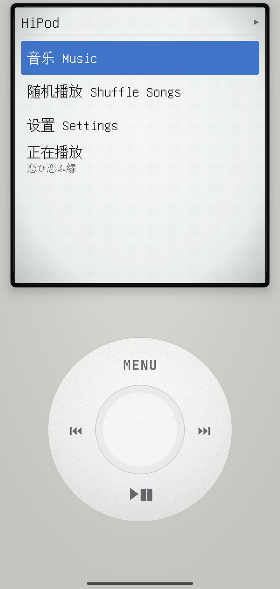
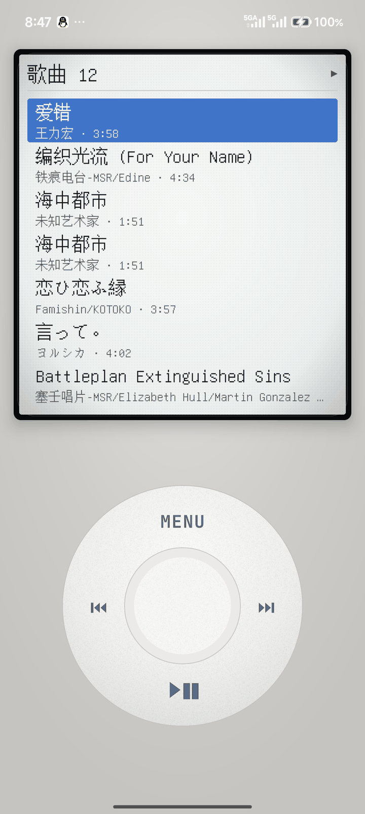
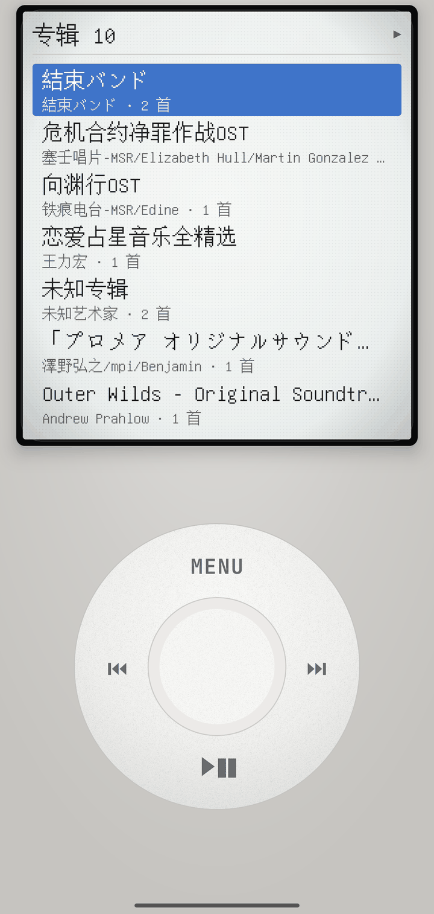
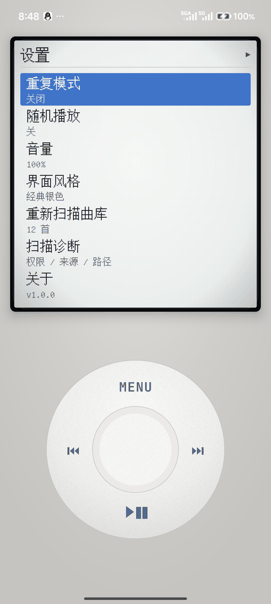
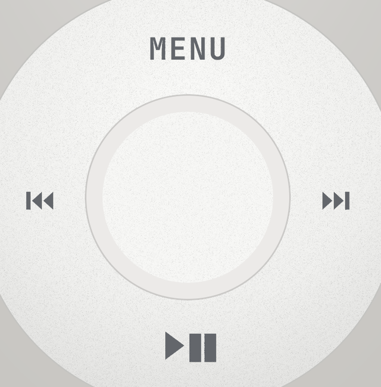

<div align="center">
  
  <h1>HiPod</h1>
  <p><b>把 iPod Classic 的点击轮装进 Android</b></p>
  <p>
    
    
    
    
  </p>
</div>

---

HiPod 是一个纯本地的 Android 音乐播放器，把 iPod Classic 的整块操作体验搬了过来：转动点击轮选歌、中键确认、MENU 返回层级、▶❚❚ 在任意界面暂停/继续。

外观走「工业复刻」路线：阳极氧化铝机身、哑光硅胶点击轮（颗粒随手指转动）、纯黑电子框屏幕、中文像素字体，贴图全部程序化生成。曲库只来自本机，**运行期零网络请求**。

## 截图

<table>
  <tr>
    <td align="center"></td>
    <td align="center"></td>
    <td align="center"></td>
    <td align="center"></td>
  </tr>
  <tr align="center">
    <td>主菜单</td><td>歌曲</td><td>专辑</td><td>设置</td>
  </tr>
</table>

<table>
  <tr>
    <td align="center"></td>
    <td align="center"></td>
  </tr>
  <tr align="center">
    <td>哑光硅胶点击轮</td><td>程序化生成的材质贴图</td>
  </tr>
</table>

> 截图取自实际运行的 release 包（arm64，脱离开发服务器），非设计稿。

## 功能

- **点击轮**：按角度累计，每 30° 一档，松手即停、无惯性；四方向 + 中键 + MENU
- **曲库**：歌曲 / 歌手 / 专辑 / 音乐四个入口；专辑内按音轨号排序
- **播放**：播放暂停、切歌、进度与音量、随机、循环；后台播放与锁屏/通知栏控制
- **正在播放**：主菜单底部常驻当前曲目，曲名过长时跑马灯滚动
- **双主题**：经典银色（仿 iPod Classic）/ 深色背光，切换后持久化
- **状态恢复**：设置与播放会话（队列、曲目、进度、音量）本地保存，重启回到上次位置

## 技术栈

| 层 | 选型 |
| --- | --- |
| 框架 | Expo SDK 57 · React Native 0.86 · React 19 · TypeScript |
| 路由 / 状态 | expo-router（类型化路由）· Zustand + AsyncStorage |
| 音频 | expo-audio（后台播放 + MediaSession 锁屏控制） |
| 曲库 | expo-media-library（MediaStore）+ 文件系统兜底扫描 + metadata-retriever |
| 视觉 | react-native-svg · gesture-handler · 自生成位图贴图 |
| 字体 | GNU Unifont（中文像素，OFL-1.1）· JetBrains Mono |

## 快速开始

```bash
npm install
npx expo prebuild -p android
npx expo run:android
```

> 依赖原生模块（expo-audio、metadata-retriever），必须用开发构建，不能跑在 Expo Go 里。需要 JDK 21 与 Android SDK；原生侧的构建修补由 `plugins/` 在 prebuild 时自动完成。

## 已知限制

- 仅 Android（最低 7.0），未适配 iOS
- 中文像素字体 12MB，release 包约 50MB
- 自签名分发，未上架应用商店
- 尚未实现：播放列表编辑、Genres、歌词、EQ

## 致谢与声明

- **字体**：[GNU Unifont](https://unifoundry.com/unifont/)，SIL OFL-1.1
- **与 Apple 无关**：iPod 与点击轮造型属 Apple 的商标/设计标识，本项目仅作个人学习与技术演示，应用名为 **HiPod**，未使用任何 Apple 素材

更细的实现说明（材质与字体管线、原生构建修补、扫描机制、打包排障）见 [docs/TECHNICAL.md](docs/TECHNICAL.md)。
